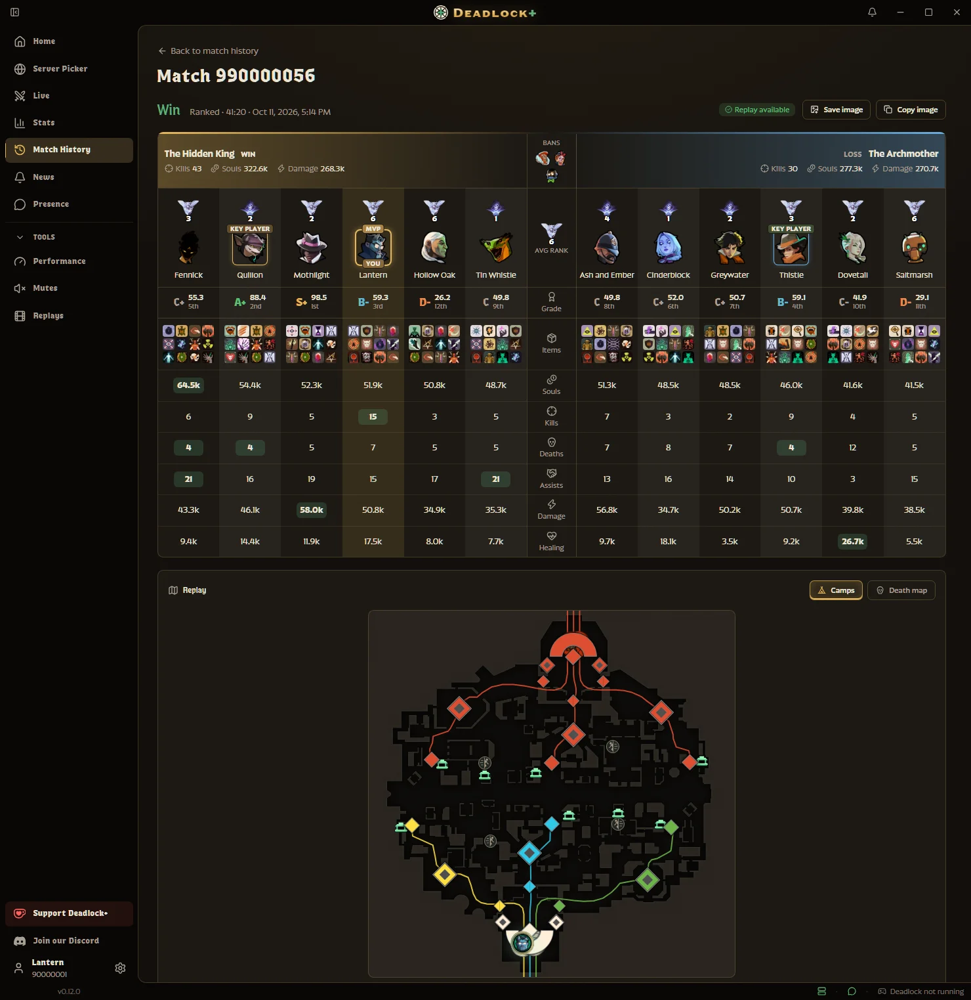
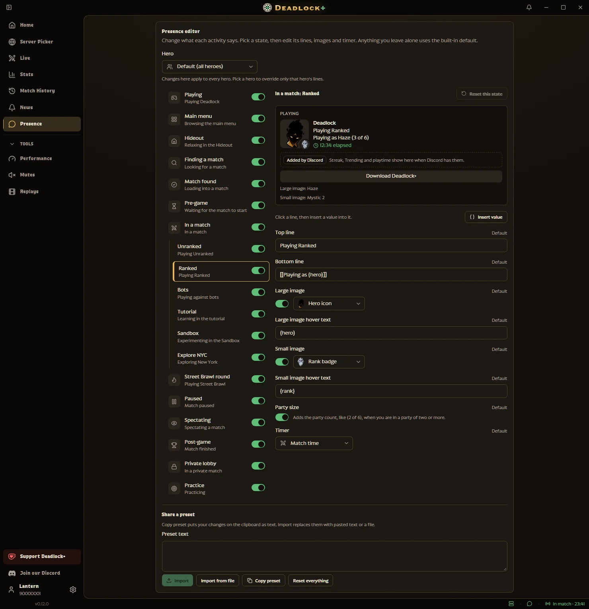
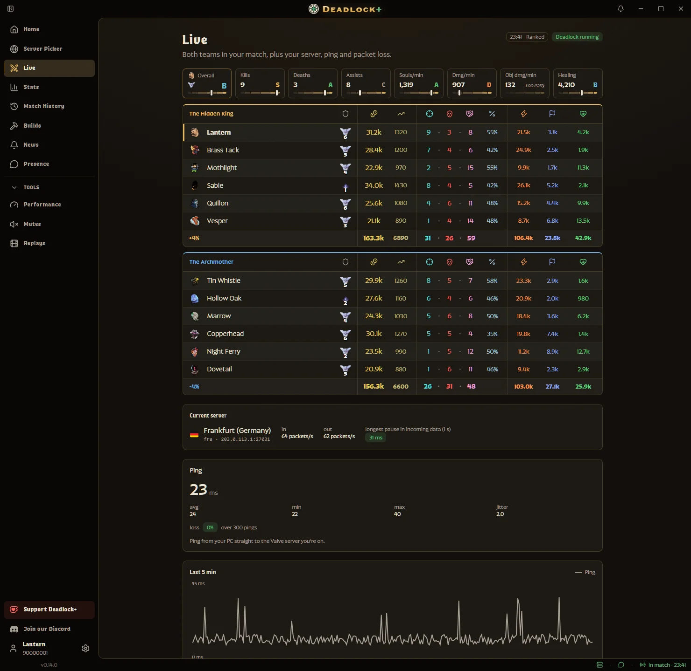
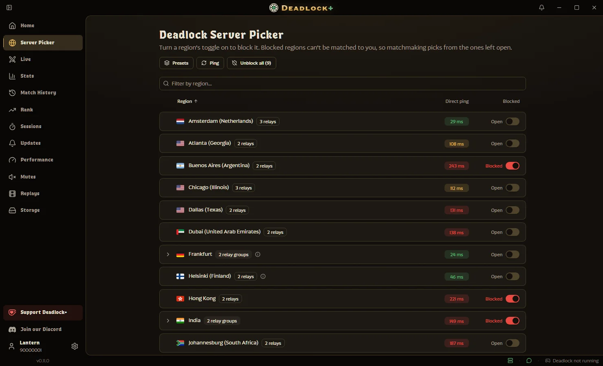
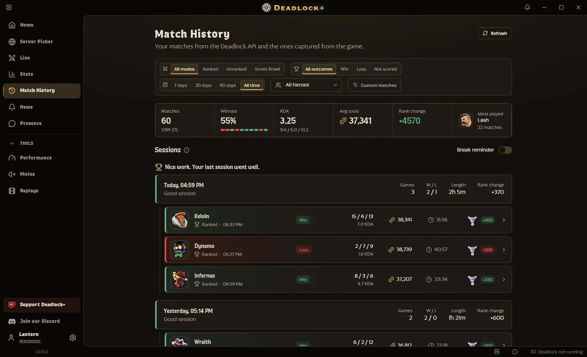
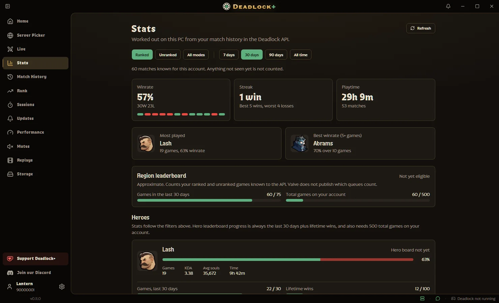
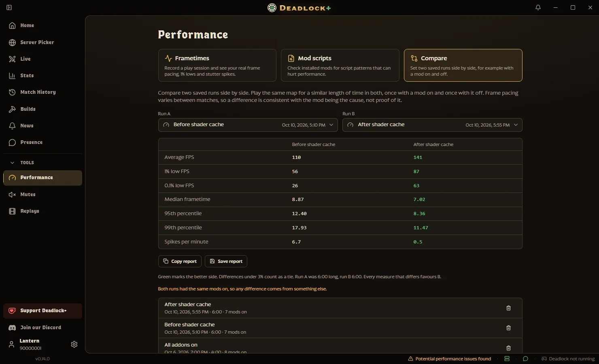
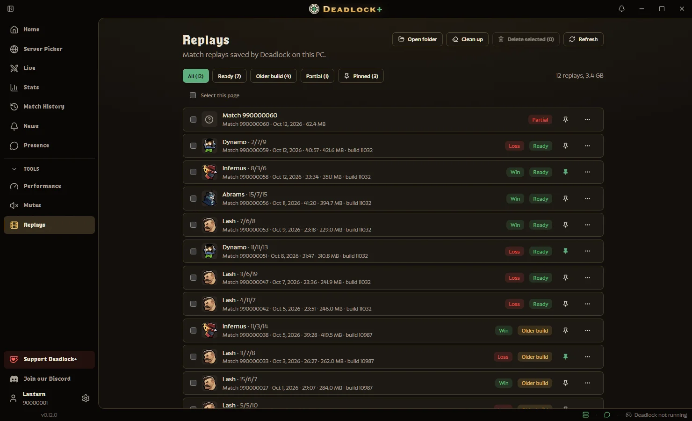
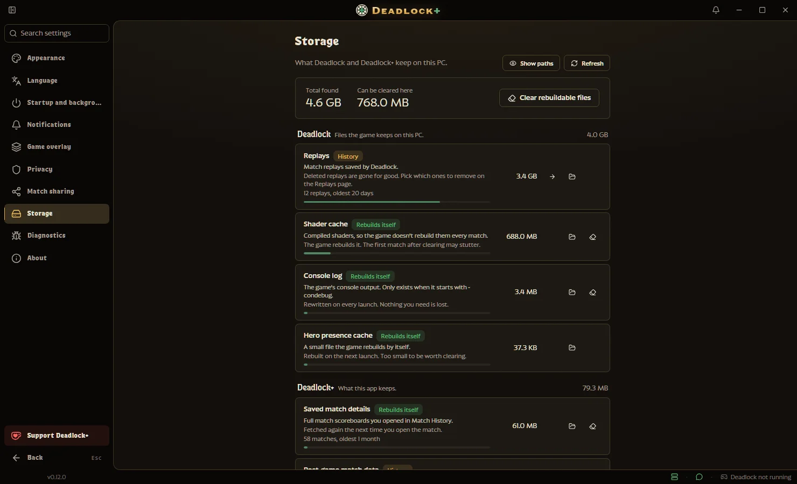
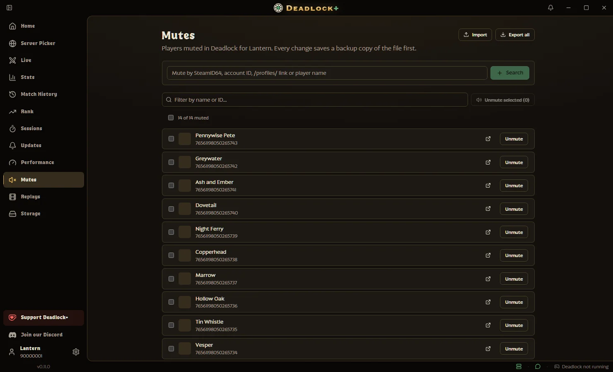

# Deadlock+

**A free companion app for [Deadlock](https://store.steampowered.com/app/1422450/).**
Rich Presence, a server picker, live match stats, your match history and more, in one app.

### [⬇️ Download for Windows](../../releases/latest) · [🌐 deadlockplus.app](https://deadlockplus.app) · [💬 Discord](https://discord.gg/652zsGZZgD)

> [!IMPORTANT]
> ## 🛡️ Is this malware? Am I safe to download this?
>
> **You don't have to take our word for it. Check it yourself.**
>
> - **All the code is open.** Every line of the app is in this repo. Read it, search it, build it yourself.
> - **The installer is built in public.** It is made by [GitHub Actions workflows](.github/workflows/) that live in this repo. Nothing is built on a private machine.
> - **The build logs are public too.** Every release build has a full log on the [Actions tab](../../actions). You can see each step that turned the source into the installer you download.
> - **No hidden steps.** What you download is what the workflow built from the code you can read.
>
> 👉 **[Download the latest release](../../releases/latest)**

> [!WARNING]
> ## ⚠️ "Windows protected your PC" / "Windows says this file could be a risk"
>
> **This is Microsoft SmartScreen. It does not mean the file is malicious.**
>
> - SmartScreen flags any app it has not seen many times before. New and small apps trigger it, whatever the code does.
> - A code-signing certificate can remove the warning early, but they cost money each year. A new free tool like this one has to earn SmartScreen's trust through downloads over time.
> - The warning says "unknown publisher". It does not say "malware".
>
> To install anyway:
>
> 1. On the blue "Windows protected your PC" screen, click **More info**.
> 2. Click **Run anyway**.
>
> If you would rather not trust a warning screen or our word, read the code and the build logs above.

> [!NOTE]
> ## 🤖 AI use in development
>
> - AI tools help write code during development. This is not hidden.
> - Design, architecture and decisions are human-made. Every change is reviewed, tested and owned by a human.
> - All art is human-made.
> - The developers do not endorse AI for artistic purposes. It is only a tool for assisting with writing and code.
> - The code is open. If you have a real problem with it, open an issue or a PR.

## ✨ What it does

<table>
<tr>
<td width="50%" valign="top">

### 💬 Discord Rich Presence

Show your hero, mode and match timer on your Discord profile, with your rank badge in ranked. Change what every state says.

</td>
<td width="50%" valign="top">

### 📡 Live

Both teams in your current match: ranks, souls, K/D/A and damage. Plus your server, ping and packet loss.

</td>
</tr>
<tr>
<td valign="top">

### 🌍 Server Picker

Block the server regions you don't want to play on. See your ping to each one first. Imports your blocks from ServerPickerX and CS2ServerPicker.

</td>
<td valign="top">

### 📜 Match History

Every match grouped into play sessions, with plain notes on when you play best. Open any match for the full scoreboard and a replay map.

</td>
</tr>
<tr>
<td valign="top">

### 📈 Stats

Progress to your next rank, demotion shields and what your next win or loss is worth. Win rate, streaks and numbers for each hero.

</td>
<td valign="top">

### ⏱️ Performance

Record FPS, your lowest dips and stutters. Check your mods for things that slow the game down. Compare two runs.

</td>
</tr>
<tr>
<td valign="top">

### 🎞️ Replays

Browse your saved replays. Pin the ones to keep and clean up the rest.

</td>
<td valign="top">

### 💾 Storage

See how much space Deadlock and Deadlock+ use. Clear files the game makes again on its own.

</td>
</tr>
<tr>
<td valign="top">

### 🔇 Mutes

View, add, unmute, export and import muted players. A backup is made before every change.

</td>
<td valign="top">

### ➕ And more

- Start with Windows and stay in the tray.
- A reminder before Steam's weekly maintenance.
- Optional alerts for patches and news.
- A break reminder after three losses in a row, if you want one.
- Themes, 20 languages and built-in update checks.

</td>
</tr>
</table>

## 🚀 Getting started

1. [Download the latest installer](../../releases/latest) and run it. If SmartScreen warns you, see the note above.
2. Open Deadlock+. A short welcome finds your game and lets you pick optional extras. Every step can be skipped.
3. Play. Deadlock+ picks up your matches on its own.

**You need:** Windows 10 or 11 with WebView2.

**Admin access:** Deadlock+ runs as a normal user. Server blocks, live connection stats and frame recording need admin rights, so Windows asks the first time you use one. Pick **Always allow** to be asked only once.

**Updates:** Deadlock+ checks for updates and installs them only when you click. Every release is signed with the project's update key, and the app rejects anything that does not match.

<b>🐧 Linux (best-effort)</b>

 

Support is best-effort and mostly untested. macOS is not supported.

- The Server Picker and Connection page should work. Both ask for your password.
- Live match data and instant match results read the game's memory through `process_vm_readv`. Many distros block that between unrelated processes (Yama `ptrace_scope`). When that happens, the Live page says so and offers a one-click fix that asks for your password:
  - deb: grants the app binary `cap_sys_ptrace` with `setcap` and restarts it.
  - AppImage: a file capability cannot work there, because the AppImage runs from a mount that ignores it. Instead, the fix sets `kernel.yama.ptrace_scope = 0` in `/etc/sysctl.d/60-deadlock-plus-ptrace.conf`. That lets any of your programs read each other's memory, not just Deadlock+.
  - If `ptrace_scope` is 3, the kernel only lowers it at boot, so restart your computer after the fix.

  A sandboxed Steam (Flatpak, snap) blocks it too. The native Linux build of the game is not readable yet; Proton is.
- Frametimes uses a Vulkan layer you install from the Performance page and enable with a Steam launch option. It is unavailable under Wine.
- Autostart, Steam and Deadlock discovery under Wine and Proton, and the AppImage and deb installers are new and untested.

If you hit a problem, please [open an issue](../../issues). A pull request with a fix is welcome.

## 🔒 Privacy

Deadlock+ reads match and status data from the running game on your PC. That stays on your PC.

It only goes online for these:

| Service | What for | What it sends |
| --- | --- | --- |
| Steam | Server list for the Server Picker, banner images on the News page | Nothing about you |
| [Deadlock API](https://api.deadlock-api.com) | Match history, rank, player names, replay details, the patch feed | Your Steam account ID, for your match history. Nothing else |
| GitHub Releases | Update checks on launch (can be turned off in Settings > Version) | Nothing about you |
| [PostHog](https://posthog.com) and [Sentry](https://sentry.io) (EU) | Anonymous usage data and error reports. On by default, asked on first launch | A random install ID, app version, OS and language. Never your Steam ID, name, IP or match data |

Two more are **opt-in** and off unless you turn them on:

- **Match data sharing** (asked on first launch). Uploads replay links from Steam's local cache so the community database can fetch those matches.
- **Salt recovery through Steam.** Signs in with your saved Steam login to fetch missing match data. Your login never leaves your PC. It never runs while Deadlock is open, and is limited to 40 matches per account per day.

<b>The full details</b>

 

- **Steam's public SDR relay list**, for the Server Picker.
- **The public [Deadlock API](https://api.deadlock-api.com)**, for player name search, mute list names, replay match details, your match history, your rank and the rank names. The Stats, Rank and Sessions pages send your Steam account ID in the match history request, and that is the only thing about you the API receives. The patch feed loads when you open the News page, and every 15 minutes if patch and news alerts are on.
- **Steam's public CDN**, for banner images on the News page.
- **GitHub Releases**, for the app's update check. It runs on launch unless you turn it off in Settings > Version, and when you press Check now. It sends no account data, and updates install only when you click.
- **Match data sharing** (opt-in, asked on first launch, changeable in Settings). It reads Deadlock replay links from Steam's local HTTP cache and uploads the match IDs, replay salts and your Steam account ID to the Deadlock API, so the community database can fetch those matches. Nothing else is read or sent.
- **Anonymous usage data and error reports** (on by default, asked about on first launch, changeable in Settings > Privacy). Usage data goes to [PostHog](https://posthog.com) (EU) and errors go to [Sentry](https://sentry.io) (EU).
  - The usage events are: app started, a heartbeat every 30 minutes while it runs, app closed, which page you open, and a click on the Discord link. Each carries the app version, your operating system and architecture, your language and a random install ID.
  - Error reports carry the error text and stack with user-name paths and secrets removed, plus the same install ID.
  - Neither service gets your Steam ID, account or computer name, file paths, IP address (it is discarded), match data or server names.
  - The install ID is random, not linked to you, and Settings > Privacy can reset it.
  - Builds made without the project's keys, including every debug build, send nothing.
- **Salt recovery through Steam** (opt-in, off by default). It reads your saved Steam login on this PC, signs in as you and asks Deadlock's game servers for the salts of matches the community database is missing. Your login never leaves your PC. It never runs while Deadlock is open and is limited to 40 matches per account per day.

The maintenance reminder and tray use only the local clock and send nothing.

## 🌐 Translations

Deadlock+ is translated by the community on [Crowdin](https://crowdin.com/project/deadlock-plus). No coding needed: translate in your browser, and approved translations ship in the next release.

Want a language that isn't there yet? [Open an issue](../../issues).

For contributors

 

- English is the source language.
- Approved translations arrive as a pull request.
- Do not edit `locales/<lang>.json` by hand. Crowdin overwrites it.
- To fix English text, change `locales/en.json` in a pull request.

How the sync works is in [CONTRIBUTING.md](CONTRIBUTING.md#translations).

## 🤝 Help and contributing

- **Questions or bugs:** ask on [Discord](https://discord.gg/652zsGZZgD) or [open an issue](../../issues). Settings > Diagnostics has a log viewer for bug reports.
- **Security issues:** see [SECURITY.md](SECURITY.md).
- **Code:** setup, checks, conventions and the release process are in [CONTRIBUTING.md](CONTRIBUTING.md).

📊 Under the hood

 

Built with [Tauri v2](https://tauri.app), [SvelteKit](https://svelte.dev) and [Rust](https://www.rust-lang.org).

Lines of code, updated on every push to `main`:

<!-- loc:start -->
| Language | Files | Lines |
| --- | ---: | ---: |
| Rust | 336 | 66,791 |
| TypeScript | 621 | 53,820 |
| Svelte | 248 | 19,070 |
| JavaScript | 31 | 2,173 |
| CSS | 4 | 393 |
| **Total** | **1,240** | **142,247** |
<!-- loc:end -->

Non-blank lines in tracked files, tests included. Translations and generated code left out.

## 📄 License

Deadlock+ is licensed under [GPL-3.0-or-later](LICENSE). [THIRD-PARTY-NOTICES.md](THIRD-PARTY-NOTICES.md) covers the bundled fonts and artwork. The Deadlock fonts remain their owners' property and will be removed on request.

Unofficial fan tool. Not made by, affiliated with or endorsed by Valve Corporation.
